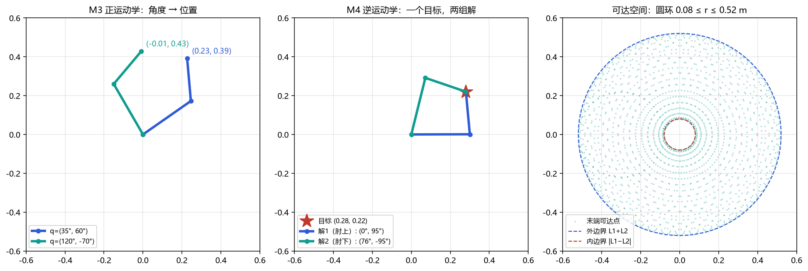
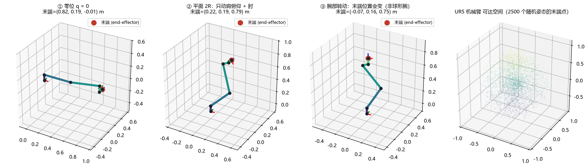
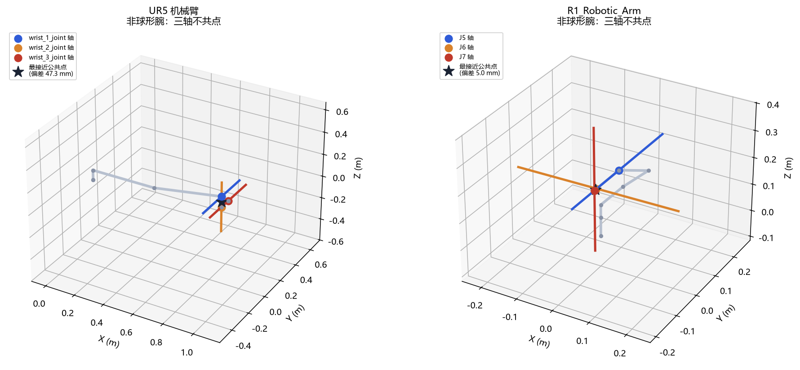
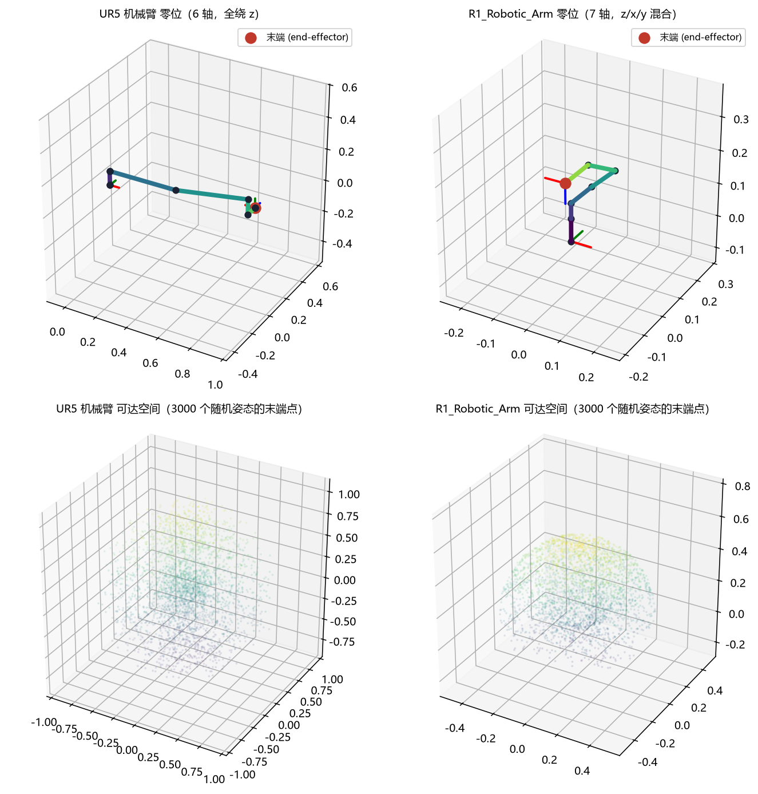

# 用三角函数"看见"机械臂

**高中跨学科课程 · 机械臂运动学与「积木式」仿真框架**

[](#-快速开始)
[](#-快速开始)
[-orange)](docs/02-UR5机械臂运动学参数.md)
[-yellowgreen)](docs/03-宇树R1机械臂运动学参数.md)

> **一句话**：让高中生用已经学过的**三角函数**，亲手算出并驱动两台真实的工业机械臂
> —— **UR5（主力，6 轴）** 与 **宇树 R1（对照，7 轴）**
> —— 从「角度 → 位置」的正运动学，到「目标 → 角度」的逆运动学。

---

## 这是什么

一门 **26 课时**的深度项目课，外加一套可直接运行的 **「积木式」Python 教学框架**。

课程的核心主张是：**三角函数是描述"空间"的语言**——`sin`/`cos` 的本质是坐标，
机械臂不过是一串"会转动的三角函数"。

框架的设计思想是：**把机械臂运动学拆成一块块积木，脚手架全部搭好，只留数学核心给学生填**。

```python
# 学生要填的，就是这样的"积木"（节选）
def rot_z(gamma):
    """绕 z 轴旋转 gamma 弧度，返回 3×3 旋转矩阵。"""
    # TODO(M7): 把 ? 换成 cos(gamma) / sin(gamma)，补上正负号
    raise NotImplementedError
```

**写出三块旋转积木 → 两台机械臂（UR5 与 R1）的正运动学都通了。**

---

## 🔍 一个反直觉的发现（课程亮点）

课本常说"六轴臂最后三根轴交于一点（球形手腕），所以位置与姿态可以解耦"。
**我们实测发现：UR5 并不是球形手腕。**

| 检查项 | UR5（主力） | 宇树 R1（对照） |
|---|---|---|
| **轴 4 ∥ 轴 6** | **平行，相距 94.65 mm** | 相交 |
| 三轴共点 | ❌ 最大偏差 **47.33 mm** | ❌ 但偏差仅 **5.01 mm** |

后果：只转 `wrist_1` 90°，UR5 末端就移动 **133.9 mm**——
所以"末端位置只由前三个关节决定"在 UR5 上**不成立**。
（MDPI *Robotics* 12(3):71, 2023 与 arXiv:2510.19081 均记载此事。）

这条结论被做成了课程 M10 的**探究实验**：学生亲手测出来、亲手推翻课本假设。
复现：`python demos/demo_wrist_geometry.py`

---

## 👀 看效果

| 平面 2R：正解 / 逆解（肘上·肘下）/ 可达圆环 | UR5 主力臂：位形 / 平面 2R 结构 / 可达空间 |
|---|---|
|  |  |

| 腕部几何检查：两台机器都不是球形手腕 | 双机对照（UR5 vs R1） |
|---|---|
|  |  |

---

## 目录结构

```
.
├── docs/                            课程文档
│   ├── 01-课程整体架构设计.md/.html    课程蓝图（含排版版，可打印）
│   ├── 02-UR5机械臂运动学参数.md       ★ 主力机型：DH 表 / 限位 / 腕部几何
│   ├── 03-宇树R1机械臂运动学参数.md     对照机型：关节表 / 结构解读
│   └── 04-UR5与R1机械臂异同对比.md     ★ 两机异同 + 实测数据 + 教学分工
├── models/
│   ├── ur5/                      UR5 模型（URDF + .dae 视觉 + .stl 碰撞，主力）
│   └── r1_7a/                    宇树 R1 模型（URDF + STL，对照）
├── armblocks/                    ★ 积木式教学框架
│   ├── core/                       平台层（已搭好，学生不动）
│   │   ├── urdf_model.py           URDF → 关节链（支持链条中的固定关节）
│   │   ├── transform.py            齐次变换 / 罗德里格斯 / rpy
│   │   ├── kinematics.py           正运动学 / 数值逆运动学
│   │   ├── geometry.py             ★ 关节轴直线 · 轴间距离 · 球形手腕判定
│   │   └── truth.py                真值参照（独立实现）
│   ├── blocks/                   ★ 学生填写（数学核心留空）
│   │   ├── trig.py                 M2/M6 极坐标 · 球坐标
│   │   ├── rotations.py            M7  rot_x / rot_y / rot_z  ★最关键
│   │   ├── planar.py               M3/M4 平面 2R 正/逆运动学
│   │   └── wrist.py                M10 欧拉角
│   └── solutions/                  参考答案（教师用）
├── demos/                        可跑的演示（8 个）
├── tests/                        自动对照真值的测试（含 DH 交叉验证）
├── tools/                        模型拉取脚本
└── outputs/                      demo 生成的图片
```

---

## 🚀 快速开始

```bash
# 1) 安装依赖
pip install -r requirements.txt

# 2) 看看你有哪些积木还没填（会逐条列出 TODO）
pytest -q

# 3) 看机械臂动起来
python demos/demo_single_link.py        # M2      一根连杆 → 圆
python demos/demo_planar_2r.py          # M3/M4   平面 2R 正解 + 肘上/肘下 + 可达圆环
python demos/demo_rotations.py          # M7      旋转矩阵到底在做什么
python demos/demo_ur5_arm.py            # ★ UR5   主力机型 + 腕部几何实测
python demos/demo_ur5_ik.py             # ★ UR5   逆运动学
python demos/demo_wrist_geometry.py     # ★ M10   球形手腕假设的实测检验
python demos/demo_r1_arm.py             # R1      对照机型七轴臂
python demos/demo_compare_arms.py       # ★ 双机对照表 + 骨架图 + 可达空间

# 4) 用「你自己的积木」驱动机械臂（填完 blocks 后）
python demos/demo_ur5_arm.py --impl blocks
python demos/demo_compare_arms.py --impl blocks

# 参考答案自检（应全绿：27 passed）
ARMBLOCKS_IMPL=solutions pytest -q

# UR5 正解 vs 教科书 DH 矩阵的独立交叉验证
pytest tests/test_ur5_dh.py -q
```

> 无图形界面环境加 `--save out.png` 即可出图。

---

## 🧩 积木填空清单

| # | 积木 | 文件 | 课程模块 | 难度 |
|---|---|---|---|---|
| 1 | `polar_to_xy` / `xy_to_polar` | `blocks/trig.py` | M2 角度→位置 | ★ |
| 2 | `sph2cart` / `cart2sph` | `blocks/trig.py` | M6 球坐标升维 | ★ |
| 3 | **`rot_x` / `rot_y` / `rot_z`** | `blocks/rotations.py` | **M7 旋转矩阵** | ★★ |
| 4 | `fk_2r` / `ik_2r` | `blocks/planar.py` | M3/M4 平面臂 | ★★ |
| 5 | `matrix_from_euler_zyx` / `euler_zyx_from_matrix` | `blocks/wrist.py` | M10 腕部姿态 | ★★★ |

每个函数都带有**逐步提示**（公式结构、该用 `atan2` 还是 `arctan`、常见坑）。

> **关键设计**：`core/transform.axis_rotation()` 在轴与坐标轴对齐时会调用学生的旋转积木。
> UR5 的关节转用 `rot_z`、关节原点里的 `rpy = (π/2,0,0)`（标准 DH 的 α）用 `rot_x`
> ——**三块积木全部会被真正调用**；R1 的 z/x/y 混合轴同样三块都用上。

---

## 📚 课程架构（五阶段 · 26 课时）

| 阶段 | 模块 | 主题 | 课时 |
|---|---|---|---|
| 一 · 启航 | M1 | FK/IK 是什么 · 认识 UR5 与 R1 与仿真平台 | 2 |
| 二 · 平面地基 | M2–M5 | 单位圆坐标化 → 平面正运动学 → 平面逆运动学 → 轨迹 | 6 |
| 三 · 升维 | M6–M8 | 球坐标 → 旋转矩阵的三角本质 → **UR5 结构 + DH + 三维正运动学** | 6 |
| 四 · 三维逆解 | M9–M11 | 位置逆解 → 姿态逆解 → 多解/奇异/**冗余（UR5 ↔ R1 对照）** | 6 |
| 五 · 综合项目 | M12–M14 | 轨迹规划 → 综合任务开发 → 展示与答辩 | 6 |

**统一教学节奏：「探 — 推 — 写 — 验」**
每个模块都是：提出问题 → **独立推导公式** → 把公式写成积木 → 跑仿真与真值对照。

详见 [`docs/01-课程整体架构设计.md`](docs/01-课程整体架构设计.md)。

---

## 🤖 机械臂模型

### UR5（主力）

**6 自由度**，标准 DH 构型，**6 个关节全部绕自身 z 轴**——"三角函数 → 机械臂"映射最干净的一台。

模型取自 [`ros-industrial/universal_robot`](https://github.com/ros-industrial/universal_robot) →
`ur_description/`（分支 `noetic-devel`，BSD 3-Clause）。

```bash
python tools/fetch_ur5_model.py     # 重新拉取模型 + 生成纯 URDF（已存在则跳过）
```

上游只提供 xacro，本仓库已展开为不依赖 ROS 的 `models/ur5/ur5.urdf`，
数值全部来自官方 4 份参数 yaml（原样存档在 `models/ur5/config/`）。
详见 [`docs/02-UR5机械臂运动学参数.md`](docs/02-UR5机械臂运动学参数.md)。

- **`shoulder_pan`** 底座方位 · **`shoulder_lift` + `elbow`** ≈ 平面 2R 臂 · **`wrist_1/2/3`** 腕部
- ⚠️ **腕部不是球形手腕**：轴 4 ∥ 轴 6，相距 94.65 mm

### 宇树 R1 机械臂（对照）

**7 自由度**（多一个冗余自由度）。模型取自
[`unitreerobotics/unitree_ros`](https://github.com/unitreerobotics/unitree_ros) →
`robots/r1_7a_description/`（BSD 3-Clause）。

```bash
python tools/fetch_unitree_model.py     # 重新拉取模型（已存在则跳过）
```

- **J1** 底座方位 · **J2/J4** 肩肘俯仰 · **J3** 臂平面倾角 · **J5–J7** 腕部（近似球形，偏差 5 mm）

两机完整异同见 [`docs/04-UR5与R1机械臂异同对比.md`](docs/04-UR5与R1机械臂异同对比.md)。

---

## 许可

- **代码**（`armblocks/`、`demos/`、`tools/`、`tests/`）：MIT
- **课程文档**（`docs/`）：CC BY-NC-SA 4.0（署名-非商业性使用-相同方式共享）
- **机械臂模型**（`models/`）：
  - `models/ur5/` —— Universal Robots / ROS-Industrial，**BSD 3-Clause**
  - `models/r1_7a/` —— Unitree Robotics，**BSD 3-Clause**

  详见 [`NOTICE.md`](NOTICE.md)
